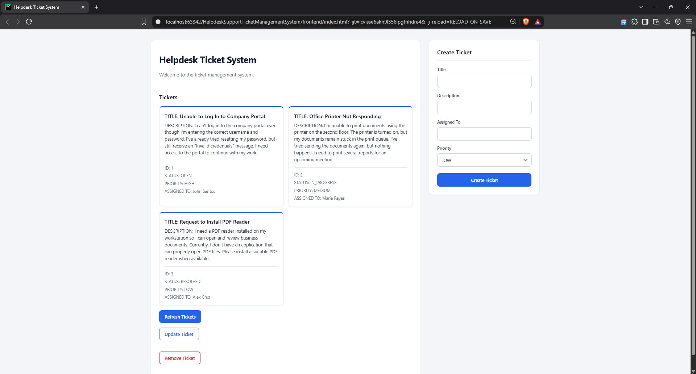
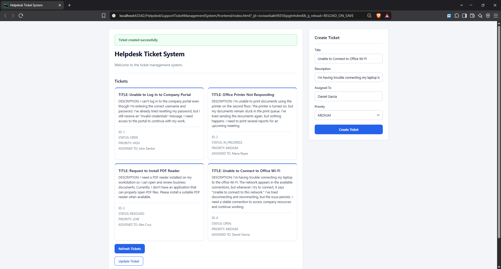
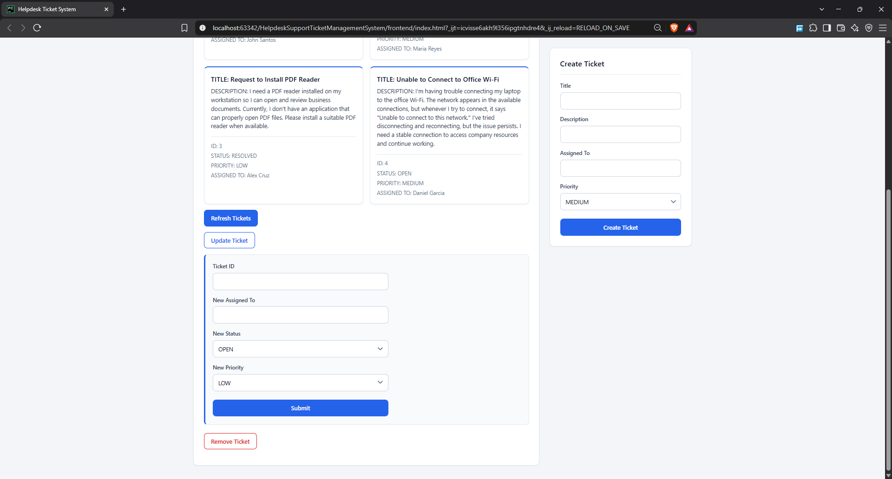

# Helpdesk Support Ticket Management System

A helpdesk ticket manager for creating, viewing, updating, and removing support tickets. It has a REST API built with FastAPI, a plain HTML/CSS/JavaScript web frontend, and a console interface. All three use the same MySQL database.

## Features

- Create, view, update, and delete tickets (full CRUD)
- Tickets have a title, description, assignee, status, and priority
- Status values: `OPEN`, `IN_PROGRESS`, `RESOLVED`, `CLOSED`
- Priority values: `LOW`, `MEDIUM`, `HIGH`, `URGENT`
- New tickets always start with the status `OPEN`
- Request validation with Pydantic (API) and input checks in the frontend and CLI
- Database failures are wrapped in a custom `DatabaseError` in the repository layer
- Automated API tests with pytest

## Tech Stack

| Technology | Purpose |
|---|---|
| Python 3.13 | Backend and CLI |
| FastAPI | REST API |
| Uvicorn | Server for the FastAPI app |
| Pydantic | Request and response validation |
| MySQL + `mysql-connector-python` | Data storage and database access |
| `python-dotenv` | Loading database settings from `.env` |
| HTML, CSS, JavaScript | Web frontend (no frameworks) |
| pytest + httpx | Testing (`httpx` is required by FastAPI's `TestClient`) |

## Screenshots

### Ticket list


### Create ticket


### Update ticket


## Project Structure

```text
.
├── api.py                # FastAPI app and endpoints
├── cli.py                # Console menu
├── database.py           # MySQL connection (reads .env)
├── exceptions.py         # DatabaseError
├── main.py               # Entry point for the console interface
├── models.py             # Ticket class, Status and Priority enums
├── ticket_manager.py     # CLI logic: prompts, validation, output
├── ticket_repository.py  # All SQL queries
├── requirements.txt
├── docs/
│   └── screenshots/      # Images used in this README
├── frontend/
│   ├── index.html
│   ├── script.js         # Fetches data from the API and updates the page
│   └── style.css
└── tests/
    └── test_api.py       # API tests
```

## Architecture

```text
Frontend (fetch) ──► api.py ───────────────┐
                                           ├──► ticket_repository.py ──► database.py ──► MySQL
CLI (cli.py) ──► ticket_manager.py ────────┘
```

- `ticket_repository.py` is the only module that runs SQL. It raises `DatabaseError` when a MySQL error occurs.
- The API and the CLI both call the same repository functions.
- `models.py` defines the `Ticket` class and the `Status` and `Priority` enums.
- `api.py` defines separate Pydantic models (`TicketCreate`, `TicketUpdate`, `TicketResponse`) for request and response validation.

## Getting Started

### Prerequisites

- Python 3.10 or later (developed with 3.13.7; the CLI uses `match` statements)
- MySQL 8.0 or later

### Installation

```bash
git clone https://github.com/ryi3l/Helpdesk-Ticket-System-Python.git
cd Helpdesk-Ticket-System-Python

python -m venv .venv
# Windows
.venv\Scripts\activate
# macOS / Linux
source .venv/bin/activate

pip install -r requirements.txt
```

### Database Setup

Create a database, then create the `tickets` table:

```sql
CREATE TABLE tickets (
  id int NOT NULL AUTO_INCREMENT,
  title varchar(255) NOT NULL,
  description text NOT NULL,
  status varchar(30) NOT NULL,
  priority varchar(30) NOT NULL,
  assigned_to varchar(100) NOT NULL,
  PRIMARY KEY (id)
);
```

### Environment Variables

Create a `.env` file in the project root (it is excluded from Git):

```env
DB_HOST=localhost
DB_PORT=3306
DB_USER=your_mysql_user
DB_PASSWORD=your_mysql_password
DB_NAME=your_database_name
```

### Running the Application

**API**

```bash
uvicorn api:app --reload
```

The API runs at `http://127.0.0.1:8000`. FastAPI's interactive documentation is available at `http://127.0.0.1:8000/docs`.

**Frontend**

With the API running, open `frontend/index.html` in PyCharm's built-in web server (right-click the file, then **Open In** > **Browser**). The page is served from `http://localhost:63342`, which is the only origin the API allows (see the CORS settings in `api.py`). Opening the file directly from the file system, or serving it on a different port, will be blocked by CORS. The frontend sends requests to `http://127.0.0.1:8000`.

**Console interface (optional)**

```bash
python main.py
```

The console menu was the original interface of this project. It works with the same database but is not required to use the application.

## API Reference

Base URL: `http://127.0.0.1:8000`

| Method | Path | Description |
|---|---|---|
| `GET` | `/tickets` | List all tickets |
| `GET` | `/tickets/{ticket_id}` | Get one ticket |
| `POST` | `/tickets` | Create a ticket |
| `PUT` | `/tickets/{ticket_id}` | Update assignee, status, and priority |
| `DELETE` | `/tickets/{ticket_id}` | Delete a ticket |

### `POST /tickets`

Request body:

```json
{
  "title": "Login issue",
  "description": "Unable to log in",
  "assigned_to": "Support Team",
  "priority": "HIGH"
}
```

Response `201 Created`:

```json
{
  "id": 1,
  "title": "Login issue",
  "description": "Unable to log in",
  "assigned_to": "Support Team",
  "status": "OPEN",
  "priority": "HIGH"
}
```

### `PUT /tickets/{ticket_id}`

Only `assigned_to`, `status`, and `priority` can be updated. Title and description cannot be changed through the API.

Request body:

```json
{
  "assigned_to": "IT Support",
  "status": "IN_PROGRESS",
  "priority": "HIGH"
}
```

Response `200 OK`: the same body that was submitted.

### `DELETE /tickets/{ticket_id}`

Response `200 OK`:

```json
{ "message": "Ticket deleted" }
```

### Error responses

| Status | When |
|---|---|
| `404 Not Found` | The ticket ID does not exist (`{"detail": "Ticket not found"}`) |
| `422 Unprocessable Entity` | Missing fields, an invalid `status` or `priority`, or a non-integer ticket ID |

## Database Schema

Table: `tickets`

| Column | Type | Constraints |
|---|---|---|
| `id` | `int` | Primary key, auto-increment |
| `title` | `varchar(255)` | Not null |
| `description` | `text` | Not null |
| `status` | `varchar(30)` | Not null |
| `priority` | `varchar(30)` | Not null |
| `assigned_to` | `varchar(100)` | Not null |

`status` and `priority` are stored as plain strings. The allowed values are enforced by the `Status` and `Priority` enums in `models.py`, not by the database.

## Testing

```bash
python -m pytest
```

Add `-q` for shorter output. Running with `python -m pytest` (rather than plain `pytest`) makes sure the project root is on the import path so that `tests/test_api.py` can import `api`.

The tests in `tests/test_api.py` use FastAPI's `TestClient` and replace the repository functions with mocks, so they run without a database. They cover:

- Listing tickets (empty and non-empty)
- Getting a ticket by ID (found and not found)
- Creating a ticket (success, missing fields, invalid priority)
- Updating a ticket (success and non-existing ID)
- Deleting a ticket (success and non-existing ID)

The CLI and the repository layer (the SQL queries) have no automated tests.

## Known Limitations

- No authentication or user accounts.
- `GET /tickets` returns all tickets with no pagination, filtering, or sorting.
- The API does not catch `DatabaseError`, so a database failure results in an unhandled server error rather than a clear API response.
- The CLI converts `assigned_to` to uppercase, but the API and frontend do not, so the same assignee can be stored differently depending on the interface.
- The frontend does not refresh the ticket list automatically after creating, updating, or removing a ticket; the Refresh button must be clicked.
- The frontend must be served from `http://localhost:63342` (PyCharm's built-in web server) unless the allowed origin in the CORS settings of `api.py` is changed.
- The API URL and the allowed CORS origin are hardcoded.